# 🏥 Health Tracker — Breast Cancer Screening Questionnaire

> **Internship Project.** This application was started during my summer 2025 software internship
> (27 July – 15 August 2025). The host organization asked me to build my own version, inspired by one of
> their projects; they did not contribute code, and none of their code or data is included here.
> The state of the code at the end of the internship is preserved under the Git tag
> [`internship-final`](../../tree/internship-final). Everything after that tag is my own follow-up work,
> documented in [Post-Internship Improvements](#-post-internship-improvements).

A Vue 3 + Firebase web application where a participant creates an account and fills in a breast-cancer
screening questionnaire (personal details, HRT/menopause, BRCA genetics, family history, allergies,
smoking, vaping and alcohol use). Administrators can review submissions in an admin panel.

| Sign in | Questionnaire | Admin panel |
|---|---|---|
| 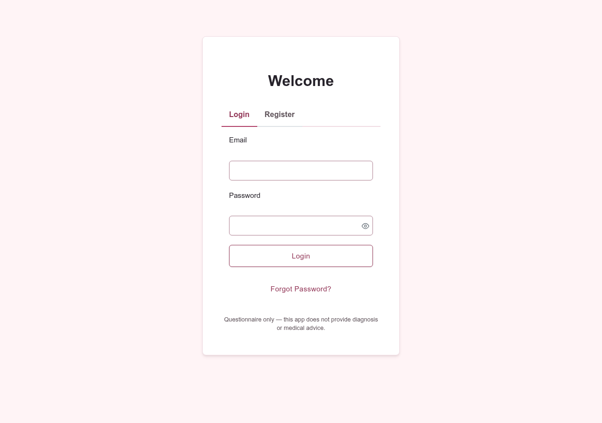 | 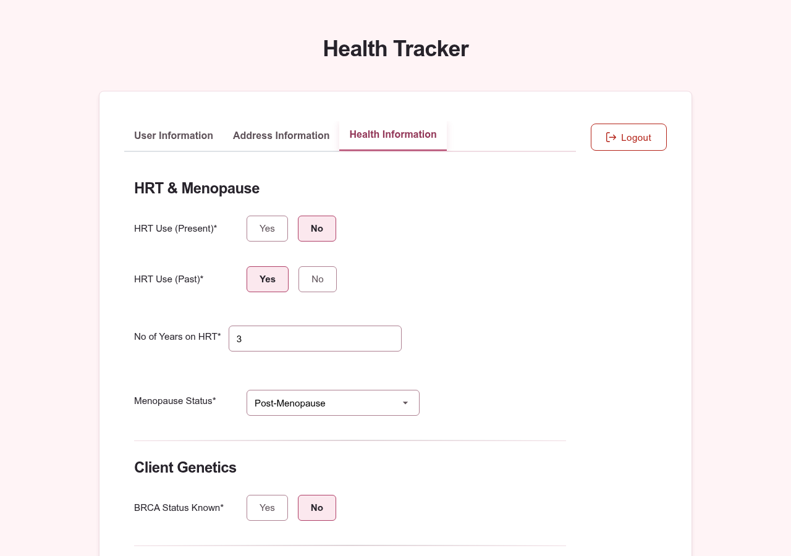 | 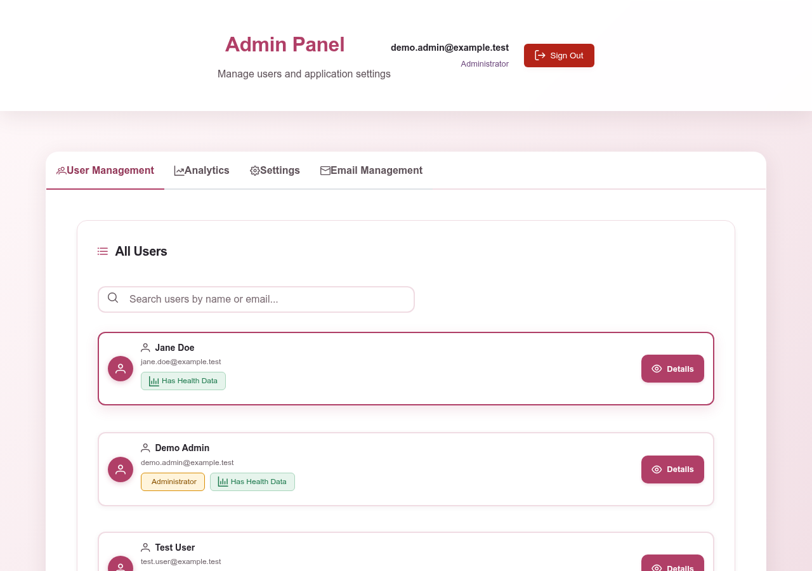 |

<sub>Screenshots taken from the real app running against the local Firebase Emulator, with synthetic accounts only.</sub>

## ⚠️ Privacy & Intended Use

- **This is not a medical device.** It does **not** provide clinical diagnosis, risk scores, screening
  decisions or medical advice. It only collects questionnaire answers. Always consult a qualified healthcare
  professional.
- **Demo / educational use.** Do not enter real patient data into a public deployment of this repository.
  Handling real health data requires a proper legal basis (e.g. KVKK / GDPR), a data processing agreement,
  audit logging, retention and deletion procedures, and a security review that this project has not had.
- **No real data in this repository.** The repository, tests, fixtures and screenshots contain only
  synthetic data (`*@example.test` accounts, "Test User", "Exampleville"). Tests run against the local
  Firebase Emulator with a `demo-*` project ID, which can never reach a real Firebase project.

## 🎓 Internship Scope

Built during the internship (commits up to `internship-final`):

- **Project setup** — Vue 3 + Vite SPA, Firebase Auth / Firestore / Hosting, GitHub Actions that build and
  deploy to Firebase Hosting on merge and create preview channels on pull requests.
- **Authentication** — email/password registration with consent checkbox, email verification, custom
  in-app password-reset and verify-email pages, password rules (6–30 chars, an uppercase letter, a number),
  email and password change with re-authentication, generic error messages to avoid account enumeration,
  client-side cooldowns for password-reset (60 s) and email-change (5 min) requests.
- **Health questionnaire** — personal and address information (country list), HRT & menopause, BRCA
  genes, family history, allergies, smoking / vaping / alcohol history with decimal-year durations
  (e.g. `0.5` = 6 months), conditional fields, real-time field validation, saving and reloading the user's
  own record from Firestore.
- **Mobile optimisation** — responsive layout, date picker, radio buttons and multi-select chips tuned for
  touch screens.
- **Admin panel** — user list and search, per-user detail view, aggregate statistics (age groups, HRT,
  BRCA, family history, lifestyle), CSV export, registration toggle and data-retention setting, and an
  **email simulation** (messages and templates are logged to the browser console, nothing is sent).

Known limitations of the internship version (fixed afterwards): admin rights were decided in the browser
(a hard-coded email list, `VITE_*` variables and an "emergency mode" that made the first visitor an admin),
and the `firestore.rules` file referenced by `firebase.json` was missing from the repository.

## 🔧 Post-Internship Improvements

Security and testing work done after the internship, without redesigning the UI:

- **Server-side authorization.** Added [`firestore.rules`](firestore.rules):
  - a user can read and write **only their own** `users/{uid}` record; the record's shape is validated and
    its email must match the signed-in account, so role fields cannot be smuggled in;
  - admins can **read** records for the admin panel but cannot modify anyone's health data;
  - the admin role is a document in `admins/{uid}`. Clients cannot create the first admin; existing admins
    can grant/revoke others but cannot revoke themselves (no lock-out);
  - `appSettings/main` is world-readable (needed on the sign-in page) and writable only by admins.
- **Trusted admin bootstrap.** Admins are created with the Firebase Admin SDK
  ([`scripts/set-admin.mjs`](scripts/set-admin.mjs)), which runs with service-account credentials and
  never in the browser.
- **Removed client-side privilege escalation.** Deleted the hard-coded admin email list, the
  `VITE_SUPER_ADMIN_EMAILS` / `VITE_EMERGENCY_ADMIN_ENABLED` variables and "emergency admin" mode. The
  router guard and admin checks now only drive the UI; Firestore Rules make the actual decision.
- **Tests with the Firebase Emulator** ([`tests/`](tests)):
  - security tests: unauthenticated access denied, users can access only their own data, users cannot make
    themselves (or anyone) admin, admins cannot edit health records or remove themselves;
  - smoke tests: registration, login, password and email change, saving and updating the questionnaire,
    and admin bootstrap through the Admin SDK script.
- **Deployment gates.** GitHub Actions run the test suite before any Hosting deploy or preview, and
  `firebase deploy` runs the rules tests as a `predeploy` step, so rules cannot be deployed with failing
  tests. Rules are never deployed automatically by CI.
- **Smaller fixes.** Settings writes no longer publish the admin's email address; the save-payload builder
  was moved to [`src/utils/profilePayload.js`](src/utils/profilePayload.js) so the tests exercise exactly
  what the app writes; README claims were corrected to match what is actually enforced.
- **Light UI fixes.** Required fields no longer show as invalid before the user has touched them,
  the sign-in page states that the app gives no medical advice, and the duplicated ✓/✗ marks in the
  password rules were removed.

## 🎨 UI Evolution — Before & After

After the security work the interface was moved from the default blue/green look to a soft pink / rose
theme that fits a breast-cancer screening context, without changing layouts or features.

| | Before | After |
|---|---|---|
| Sign in | 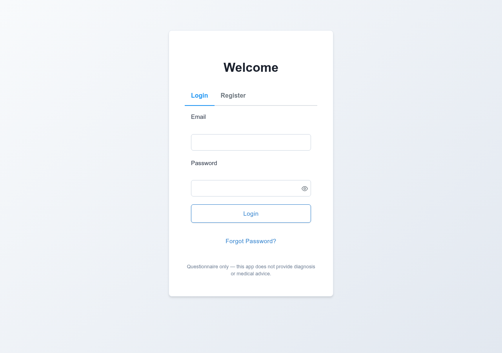 |  |
| Questionnaire | 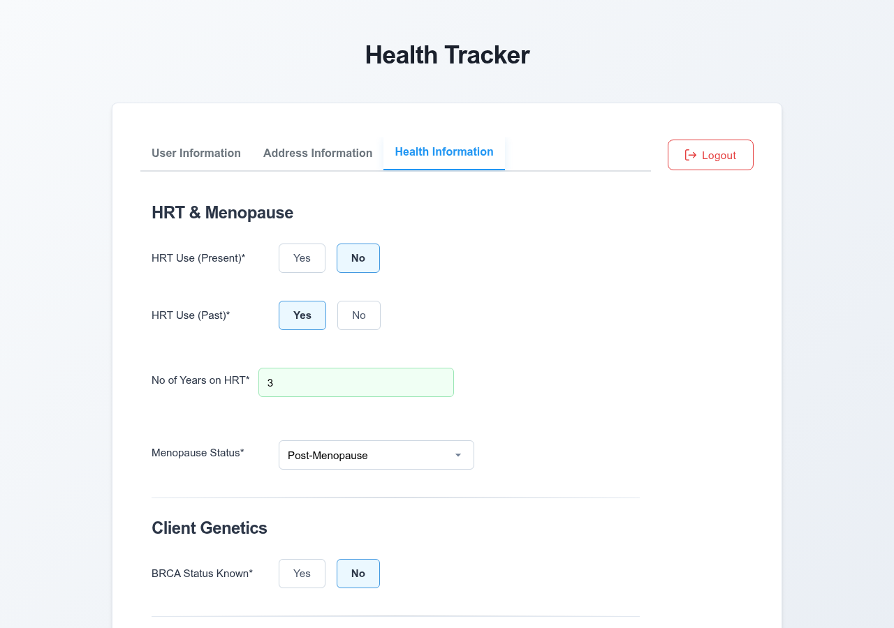 |  |
| Admin panel | 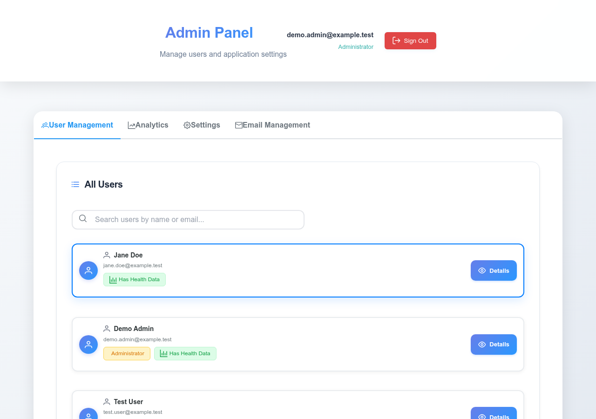 |  |

<details>
<summary>Mobile (390 px)</summary>

| Before | After |
|---|---|
| 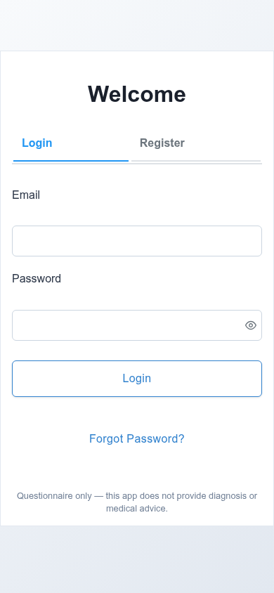 | 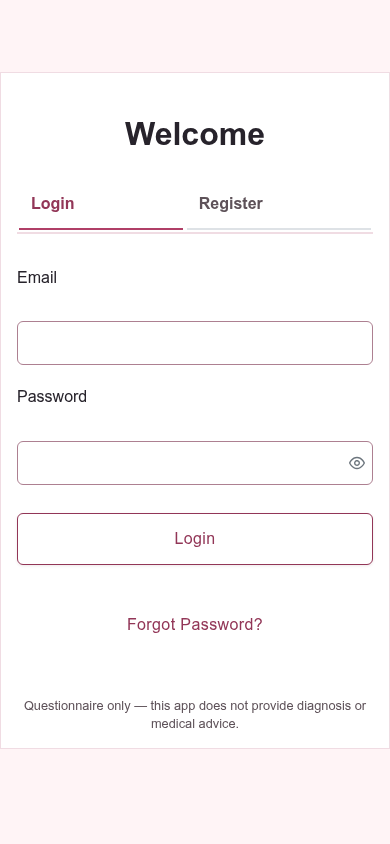 |
| 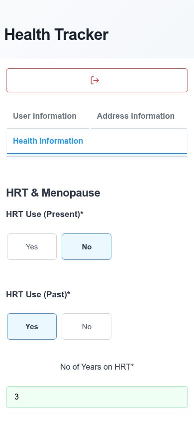 | 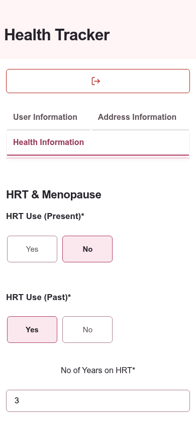 |
| 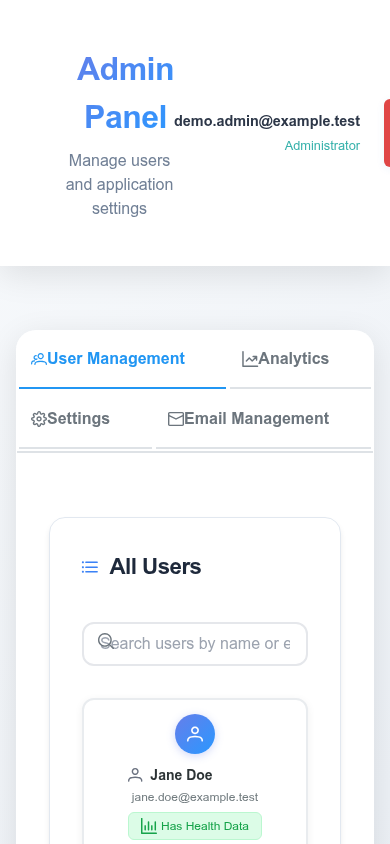 | 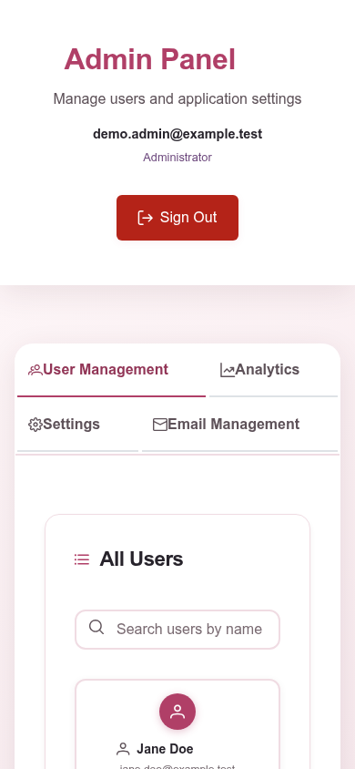 |

</details>

Design decisions:

- **One set of tokens.** All colors live as CSS custom properties at the top of
  [`src/style/main.css`](src/style/main.css); component styles and the PrimeVue theme variables refer to
  them, and a small "PrimeVue theme bridge" maps the components the app uses (buttons, inputs, tabs,
  checkbox, dropdown, multiselect, date picker, toast) onto the same tokens.
- **Palette.** Background `#FFF4F6`, blush surface `#F5DCE4`, text `#27232B`, deep rose `#923657`.
  The primary rose was darkened from `#C34D75` to `#B03F67` so that it passes WCAG AA as text on the
  light backgrounds (5.2:1) and with white text on buttons (5.6:1); `#C34D75` is kept for decoration only.
- **States stay distinct.** Error = red `#B42318`, success = green `#1E7A4E`, warning = amber, each with
  its own tinted background; the brand rose is never used for errors. A muted plum (`#6E4A7E`) is the
  secondary accent for charts and badges.
- **Accessibility.** Body, label and link text is ≥ 4.5:1 on the page and card backgrounds (the lighter
  "subtle" tone is limited to placeholders, disabled states and icons), form-control borders are ≥ 3:1, and keyboard focus always shows a 2 px deep-rose outline (the old CSS removed outlines in
  ~20 places).
- **Mobile.** The admin header now wraps on small screens (the Sign Out button used to be cut off) and
  the search icon no longer overlaps the placeholder.

## 🔒 Security Model

| Concern | Enforced by | Notes |
|---|---|---|
| Who can read/write a health record | Firestore Rules | Owner only; admins read-only |
| Who is an admin | `admins/{uid}` + Firestore Rules | First admin via Admin SDK only |
| Record shape / no role fields in user data | Firestore Rules | Field values (ranges, formats) are validated in the UI only |
| Password strength | Firebase Auth + UI | UI rules are stricter than Firebase's default |
| Password-reset / email-change cooldowns | UI only | Firebase Auth applies its own server-side rate limits |
| "Allow registration" toggle | UI only | Firebase Auth sign-up itself cannot be blocked from Firestore Rules |
| XSS | Vue template escaping | No `v-html` with user input |

The Firebase web config (`VITE_FIREBASE_*`) is public by design; protection comes from the rules above.
Restrict the API key to your domains in Google Cloud Console for production.

## 🛠️ Tech Stack

- **Vue 3**, **Vue Router**, **PrimeVue**, **Vite**
- **Firebase Authentication**, **Cloud Firestore**, **Firebase Hosting**
- **Firebase Emulator Suite**, `@firebase/rules-unit-testing`, Node's built-in test runner
- **GitHub Actions** for tests, preview channels and deployment

## 🚀 Getting Started

### Prerequisites

- Node.js 20+ and npm
- Java 21+ (required by the Firebase Emulator)
- A Firebase project with Email/Password Authentication and Firestore enabled (only for real deployments)

### Local development with the emulators (no Firebase project needed)

```bash
git clone https://github.com/Contraill/Breast-Cancer-Tracker.git
cd Breast-Cancer-Tracker
npm install
cp .env.example .env            # set VITE_USE_EMULATORS="true"
npm run emulators               # terminal 1: Auth + Firestore emulators
npm run dev                     # terminal 2: http://localhost:5173
```

To open the admin panel locally, register an account in the app and then:

```bash
FIRESTORE_EMULATOR_HOST=127.0.0.1:8080 FIREBASE_AUTH_EMULATOR_HOST=127.0.0.1:9099 \
GCLOUD_PROJECT=demo-bct npm run admin:grant -- you@example.test
```

### Tests

```bash
npm test             # security rules + smoke tests (starts the emulators automatically)
npm run test:rules   # security rules only
```

### Admin Setup (real Firebase project)

Admin rights are never configured through environment variables. Grant the first admin with the Admin SDK:

```bash
# Service account key from Firebase Console > Project settings > Service accounts (keep it out of git)
export GOOGLE_APPLICATION_CREDENTIALS=/path/to/service-account.json
npm run admin:grant -- admin@your-domain.com
npm run admin:revoke -- admin@your-domain.com
```

The user must have registered first. After that, admins can grant or revoke other admins from the admin panel.

### Deployment

Deploy the rules **before** a frontend that depends on them:

```bash
firebase login
npm run deploy-rules      # runs the rules tests first (predeploy), then deploys firestore.rules
npm run deploy-hosting    # or push to main and let GitHub Actions deploy after the tests pass
```

### Available Scripts

| Script | Description |
|---|---|
| `npm run dev` | Start the Vite dev server |
| `npm run build` / `npm run preview` | Production build / preview it |
| `npm run emulators` | Start the Auth + Firestore emulators (`demo-bct` project) |
| `npm test` / `npm run test:rules` | All tests / rules tests only |
| `npm run admin:grant -- <email>` / `admin:revoke` | Assign or remove admin with the Admin SDK |
| `npm run deploy-rules` / `deploy-hosting` / `deploy` | Firebase deploys (rules deploys are test-gated) |

## 📁 Project Structure

```
├── firestore.rules              # Server-side authorization (tested in tests/)
├── firebase.json                # Hosting, Firestore and emulator configuration
├── scripts/set-admin.mjs        # Admin SDK role assignment
├── tests/
│   ├── firestore.rules.test.mjs # Security rules tests
│   ├── smoke.test.mjs           # Auth + data flow smoke tests
│   └── fakeForm.mjs             # Synthetic questionnaire data
└── src/
    ├── firebase.js              # Firebase init (+ optional emulator connection)
    ├── router/index.js          # Routes and UI guards
    ├── utils/AdminManager.js    # Admin UI helpers (rules make the real decision)
    ├── utils/profilePayload.js  # Firestore shape of a user's record
    ├── views/AuthView.vue       # Sign in, registration, password reset
    ├── views/HomeView.vue       # Questionnaire and account settings
    ├── views/AdminView.vue      # Admin panel
    └── style/                   # Global and admin styles
```

## 📄 License

Released under the [MIT License](LICENSE).

## 👨‍💻 Developer

**Contrail** — [GitHub Profile](https://github.com/Contraill)
